# Paso 4.1-4.2 — Declaración de Alcance, EDT y Entregables

## 1. Objetivos del proyecto

| Objetivo | Descripción |
| -------- | ----------- |
| Objetivo general | Desarrollar una plataforma web denominada PetAdopt que conecte a personas interesadas en adoptar mascotas con refugios y centros de adopción de su área, facilitando la búsqueda, el contacto y la adopción responsable. |
| Objetivo específico 1 | Implementar perfiles personales para adoptantes y perfiles gestionables para refugios. |
| Objetivo específico 2 | Implementar un motor de búsqueda que permita filtrar mascotas por tipo, tamaño, edad y otros criterios relevantes. |
| Objetivo específico 3 | Implementar un canal de comunicación entre adoptantes y administradores de refugios, junto con notificaciones de nuevas mascotas que coincidan con las preferencias del adoptante. |
| Objetivo específico 4 | Permitir la publicación y actualización de mascotas disponibles, así como la valoración de la experiencia con los refugios mediante calificaciones y reseñas. |
| Objetivo específico 5 | Entregar una plataforma usable, segura, disponible, escalable y mantenible que cumpla los umbrales de calidad establecidos en el modelo verbal. |
| Meta de impacto | Contribuir a que al menos 500 mascotas sean adoptadas durante el primer año y fomentar una comunidad activa de adopción responsable. La adopción real depende de usuarios y refugios externos y se registra como meta de resultado, no como funcionalidad propia del sistema. |

## 2. Restricciones del proyecto

| Tipo | Restricción |
| ---- | ----------- |
| Tiempo | La ejecución estimada es de seis meses, incluyendo desarrollo, pruebas y lanzamiento. |
| Tecnología de frontend | La interfaz debe desarrollarse con HTML, CSS y JavaScript. |
| Tecnología de backend | El backend debe desarrollarse en Python con Django. |
| Datos | La información debe almacenarse en una base de datos SQL. |
| Plataforma | La solución entregada es una aplicación web; no se incluyen aplicaciones móviles nativas. |
| Rendimiento | Las cargas de páginas y las acciones críticas, incluida la búsqueda, no deben exceder 3 segundos y 2 segundos respectivamente bajo las condiciones definidas en las pruebas. |
| Disponibilidad | El sistema debe estar operativo al menos el 99% del tiempo. |
| Escalabilidad y carga | La plataforma debe funcionar con al menos 1.000 usuarios simultáneos sin fallos y adaptarse al crecimiento de la base de usuarios. |
| Seguridad | La información personal debe protegirse mediante cifrado y deben realizarse pruebas periódicas de vulnerabilidad. |
| Usabilidad | El diseño debe ser intuitivo y obtener al menos 80 puntos en la escala System Usability Scale (SUS). |
| Accesibilidad | La interfaz debe cumplir las pautas WCAG 2.1. |
| Mantenibilidad | El código debe estar estructurado y documentado para facilitar futuras actualizaciones y mejoras. |
| Entorno académico | El alcance se limita a los artefactos y al desarrollo definido por la entrega; no presupone proveedores, despliegues, servicios comerciales ni aprobaciones externas no descritas en el modelo verbal. |

## 3. Qué entra en el alcance

- Registro y gestión de perfiles personales de adoptantes.
- Registro y gestión de perfiles de refugios y centros de adopción.
- Consulta y visualización de información de refugios según ubicación o preferencias del usuario.
- Publicación, consulta y actualización de perfiles de mascotas, incluyendo su estado de adopción.
- Búsqueda y filtrado de mascotas por tipo, tamaño, edad y otros filtros relevantes acordados durante el análisis de requisitos.
- Recepción de notificaciones sobre nuevas mascotas disponibles que coincidan con las preferencias del adoptante.
- Comunicación entre adoptantes y administradores de refugios mediante consultas y respuestas dentro de la plataforma.
- Registro de calificaciones y reseñas de adoptantes sobre su experiencia con los refugios.
- Diseño responsive e inclusivo de la interfaz web conforme a las pautas WCAG 2.1.
- Implementación de cifrado para la protección de datos personales y pruebas de vulnerabilidad.
- Pruebas funcionales y no funcionales de rendimiento, carga, disponibilidad, usabilidad, seguridad y mantenibilidad.
- Preparación del lanzamiento y documentación técnica y de usuario requerida por el proyecto.
- Gestión del alcance, riesgos, estimación, cronograma, presupuesto y demás artefactos de planificación definidos en esta entrega.

## 4. Qué NO entra en el alcance

- Desarrollo de aplicaciones móviles nativas para Android o iOS.
- Gestión física de adopciones, transporte de mascotas, visitas domiciliarias, firmas notariales o entrega presencial de animales.
- Procesos clínicos, historias médicas veterinarias, agendamiento de citas, servicios veterinarios o gestión de pagos y facturación.
- Integración con pasarelas de pago, sistemas tributarios, redes sociales, sistemas veterinarios o plataformas externas no especificadas en el modelo verbal.
- Operación comercial 24/7 por una organización real, contratación de proveedores de infraestructura o compra de dominios y certificados fuera del ejercicio académico.
- Garantía de que se alcanzarán 500 adopciones reales en el primer año; esta cifra se considera una meta de impacto que depende de la participación externa de usuarios y refugios.
- Modificación de datos o políticas de refugios ajenos sin mecanismos de administración explícitamente autorizados por el proyecto.
- Construcción de una red comunitaria general que incluya foros sociales, donaciones o comercio de productos no asociados a los procesos de adopción descritos.

> Los criterios de aceptación y las exclusiones no se redactan como
> secciones separadas: quedan cubiertos implícitamente por los
> requisitos no funcionales y por lo declarado aquí como fuera de alcance.

## 5. EDT / WBS

La siguiente descomposición organiza el proyecto por entregables y productos de trabajo. Los paquetes pueden convertirse posteriormente en issues o actividades del cronograma.

```mermaid
flowchart TD
    A[1. Proyecto PetAdopt]

    A --> B[1.1 Planificación y gestión]
    B --> B1[1.1.1 Alcance y EDT]
    B --> B2[1.1.2 Riesgos]
    B --> B3[1.1.3 Cronograma y presupuesto]
    B --> B4[1.1.4 Plan PMP y contrato]

    A --> C[1.2 Ingeniería de requisitos]
    C --> C1[1.2.1 Modelo y extensión verbal]
    C --> C2[1.2.2 Actores y necesidades]
    C --> C3[1.2.3 Requisitos funcionales y no funcionales]
    C --> C4[1.2.4 Requisitos de interfaz]

    A --> D[1.3 Diseño de la plataforma]
    D --> D1[1.3.1 Arquitectura web]
    D --> D2[1.3.2 Diseño de datos SQL]
    D --> D3[1.3.3 Diseño de interfaz accesible]
    D --> D4[1.3.4 Definición del modelo de ciclo de vida]

    A --> E[1.4 Desarrollo]
    E --> E1[1.4.1 Perfiles de adoptantes]
    E --> E2[1.4.2 Perfiles y publicación de refugios]
    E --> E3[1.4.3 Gestión de mascotas]
    E --> E4[1.4.4 Búsqueda y filtros]
    E --> E5[1.4.5 Comunicación y notificaciones]
    E --> E6[1.4.6 Calificaciones y reseñas]
    E --> E7[1.4.7 Seguridad y cifrado]

    A --> F[1.5 Verificación y validación]
    F --> F1[1.5.1 Pruebas funcionales]
    F --> F2[1.5.2 Pruebas de rendimiento y carga]
    F --> F3[1.5.3 Pruebas de seguridad y vulnerabilidad]
    F --> F4[1.5.4 Pruebas de usabilidad y accesibilidad]
    F --> F5[1.5.5 Corrección de defectos]

    A --> G[1.6 Preparación y entrega]
    G --> G1[1.6.1 Documentación técnica]
    G --> G2[1.6.2 Manual de usuario]
    G --> G3[1.6.3 Entregables del lanzamiento]
    G --> G4[1.6.4 Revisión final y cierre]
```

## 6. Índice de entregables del proyecto

A continuación se enumeran todos los artefactos que componen este proyecto, dónde viven y qué contienen, a modo de índice rápido de todo el repositorio.

| Artefacto                                         | Ubicación                                                                                          | Contenido, según la rúbrica                                                                                                                                                                                                                |
| ------------------------------------------------- | -------------------------------------------------------------------------------------------------- | ------------------------------------------------------------------------------------------------------------------------------------------------------------------------------------------------------------------------------------------ |
| Extensión del modelo verbal                       | Wiki: `01-Extension-Modelo-Verbal`                                                                 | Funcionalidad adicional no contemplada explícitamente en el enunciado, junto con el requisito de calidad asociado, señaladas como decisión del equipo.                                                                                     |
| Tailoring de requisitos (referencia)              | Wiki: `02a-Tailoring-Normativo-Requisitos`                                                         | Ejemplo resuelto de _tailoring_ de ISO/IEC/IEEE 12207 y CMMI, articulado con BABOK v3, para el proceso de requisitos. Material de referencia, no es un entregable evaluable por sí mismo.                                                  |
| Actores                                           | Wiki: `02b-Actores`                                                                                | Actores y roles mencionados o inferibles del modelo verbal y de su extensión.                                                                                                                                                              |
| Necesidades del negocio                           | Wiki: `02c-Necesidades-Negocio`                                                                    | El porqué de alto nivel del proyecto: qué problema de negocio resuelve.                                                                                                                                                                    |
| Necesidades de los interesados                    | Wiki: `02d-Necesidades-Interesados`                                                                | Necesidades derivadas de los actores y de las necesidades de negocio: qué requiere cada actor para que la necesidad de negocio se satisfaga.                                                                                               |
| Requisitos de interfaz                            | Wiki: `02e-Requisitos-Interfaz`                                                                    | Interacciones con otros sistemas o servicios mencionados o inferidos (APIs, pasarelas de pago, notificaciones, etc.).                                                                                                                      |
| Requisitos funcionales/no funcionales             | Issues: módulos (`tipo:modulo`, issues padre) y requisitos (`tipo:funcional` / `tipo:no-funcional`, sub-issues) + Project, vista **Registro de Requisitos** | Requisitos de solución: funcionales, agrupados por módulo del sistema, y no funcionales.                                                                                                                                                   |
| Mapa de procesos (completo)                       | Wiki: `03a-Mapa-Procesos-Caracterizacion`                                                           | Selección justificada de los procesos del ciclo de vida (estratégicos, de apoyo y clave), con su desglose de Entradas, Actividades, Salidas y Recursos, y el diagrama del mapa de procesos resultante.                                     |
| Mapa de procesos (clave, generado)                | `docs/mapa-procesos.md`                                                                            | Representación interactiva, generada por el workflow de GitHub Actions, de las Entradas, Actividades, Salidas y Recursos de los procesos clave seleccionados.                                                                              |
| Tailoring de planificación (referencia)           | Wiki: `04a-Tailoring-Normativo-Planificacion-Proyecto`                                             | Ejemplo resuelto de _tailoring_ de ISO/IEC/IEEE 12207 y CMMI para el proceso de planificación del proyecto. Material de referencia, no es un entregable evaluable por sí mismo.                                                            |
| Alcance, EDT y entregables                        | Wiki: `04b-Declaracion-Alcance`                                                                    | Objetivos, restricciones, declaración de alcance (qué entra y qué no entra en el proyecto) y Estructura de Desglose del Trabajo (EDT/WBS), con su diagrama correspondiente.                                                                |
| Modelo de ciclo de vida                           | Wiki: `04c-Modelo-Ciclo-Vida`                                                                      | Definición formal y justificada del modelo de ciclo de vida del proyecto, a partir del mapa de procesos del Paso 3, con su representación gráfica.                                                                                         |
| Introducción a gestión de riesgos                 | Wiki: `05a-Intro-Gestion-Riesgos`                                                                   | _Tailoring_ de ISO/IEC/IEEE 12207 y CMMI aplicado a la gestión de riesgos, con cita textual de las cláusulas seleccionadas, e introducción de cómo el equipo la abordará.                                                                  |
| Registro de riesgos                               | Issues (label `riesgo`) + Project, vista **Registro de Riesgos**                                   | Riesgos identificados, documentados con causa, efecto, responsable, análisis cualitativo (probabilidad × impacto) y plan de acción, consolidados como línea base de riesgos del proyecto.                                                  |
| Introducción a estimación + FPA/Planning Poker    | Wiki: `06a-Intro-Estimacion`                                                                        | _Tailoring_ de ISO/IEC/IEEE 12207 y CMMI aplicado a la estimación, el cronograma y el presupuesto, con cita textual de las cláusulas seleccionadas; estimación de esfuerzos mediante Análisis de Puntos de Función (FPA) y Planning Poker. |
| Cronograma, PERT y ruta crítica                   | Issues (label `actividad`) + Project, vista **Roadmap**                                            | Cronograma por hitos y actividades, con estimación PERT (optimista, más probable, pesimista), análisis de ruta crítica y diagrama de Gantt.                                                                                                |
| Presupuesto y curva S                             | Wiki: `06b-Presupuesto-Curva-S`                                                                     | Presupuesto con reservas de contingencia y de gestión, integrado en una tabla o gráfico de curva S.                                                                                                                                        |
| Aplicación normativa (identificación y selección) | Wiki: `07a-Aplicacion-Normativa`                                                                   | Identificación de los procesos involucrados en la gestión de calidad, riesgos y ruta crítica, y selección justificada de un mínimo de tres procesos críticos, siguiendo el principio de Pareto.                                            |
| Caracterización de procesos (una por proceso)     | Wiki: `07b-Molde-Caracterizacion-Proceso` (molde, no se modifica) y una página por proceso (`07c-Proceso-<Nombre>`, `07d-Proceso-<Nombre>`, ...)                  | Caracterización de cada proceso seleccionado según ISO/IEC/IEEE 12207 y CMMI, con cita textual de cada cláusula, y narrativa de implementación que integra explícitamente todos los elementos seleccionados.                               |
| PMP                                               | Wiki: `08a-PMP`                                                                                    | Estructura del Plan de Gestión del Proyecto según la ISO 16326:2009, con la cobertura explícita de cada sección de la norma a partir de lo desarrollado en los Pasos 1 a 7.                                                                |
| Contrato                                          | Wiki: `08b-Contrato`                                                                               | Contrato del proyecto, según la forma y estructura explicada en clase.                                                                                                                                                                     |

> **Nota:** cualquier página de wiki nueva que se genere durante el proyecto (por ejemplo, al duplicar el molde de caracterización del Paso 7 para procesos adicionales) debe añadirse **tanto a este índice como a la barra de navegación** (`_Sidebar.md`). Un artefacto que no aparece en ninguno de los dos lugares se considera, a efectos prácticos, inexistente para quien lo califica.
